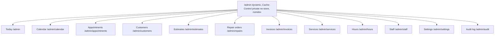
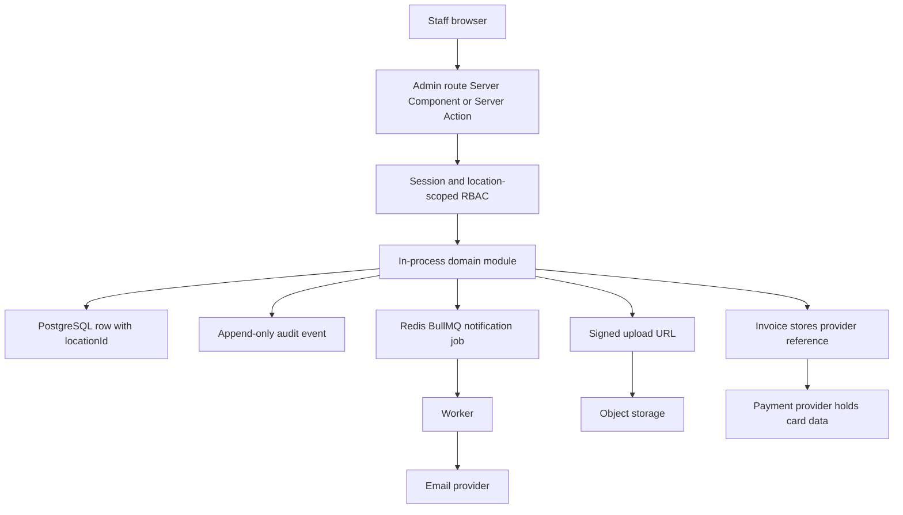

# Berlin AutoWorks

**Reliable repair. Straight answers. Ready for the road.**

Berlin AutoWorks is a fictional full-service auto repair shop in Berlin, New Jersey. This repository holds the product and architecture plan for its website and web app: a public marketing site, a customer portal, and a staff workspace in one modular application.

The launch shop is a single location. Every transactional record carries a location id, so more shops can be added later without rewriting the data model.

The app scaffold lives in this repository. The full specification — sitemap, user flows, rendering strategy, stack, and non-functional requirements — is in [PLANNING.md](PLANNING.md).

## Placeholder shop details

These stand in until real name, address, and phone details are provided.

| | |
| --- | --- |
| Brand | Berlin AutoWorks |
| Address | 123 Route 73, Berlin, NJ 08009 |
| Phone | (856) 555-0147 |
| Email | service@berlinautoworks.example |
| Hours | Mon–Fri 8:00 AM–6:00 PM; Sat 8:00 AM–3:00 PM; Sunday closed |

## What a customer can do

- Book service as a guest or from an account
- Request an estimate, then approve it, decline it, or ask for changes
- Follow a repair from intake through pickup
- Pay an invoice
- Keep vehicles and service history on file

## Surfaces

Three surfaces share one codebase and one API boundary.

| Surface | Who it is for | Auth | Primary goal |
| --- | --- | --- | --- |
| Public site | Prospects and drivers | None | Build trust and convert to a booking or estimate |
| Customer portal (`/account`) | Existing customers | Required | Book, approve estimates, track repairs, pay invoices |
| Staff workspace (`/admin`) | Advisors, technicians, managers | Required, with roles | Run the day: schedule, estimates, repair orders, invoices |

**Public pages:** home, services, about, fleet, contact, book, estimate request, privacy, terms, and accessibility.

**Customer portal:** dashboard, vehicles, appointments, estimates, repair orders, invoices, profile, and security.

**Staff workspace:** operations dashboard, calendar, appointments, customers, estimates, repair orders, invoices, service catalog, hours, staff, settings, and an audit log. Launch roles are service advisor, technician, and manager/owner.

The route map follows that nav. Every `/admin` route is dynamic, sent with `Cache-Control: private, no-store`, and marked noindex. The write path is the same for a status change, a photo, or an invoice. Role access, the advisor’s day, and repair statuses are in [PLANNING.md](PLANNING.md) section 1.4.1.





## Services

Preventive maintenance and oil changes, diagnostics, brakes, tires and alignment, battery / starter / alternator, suspension and steering, engine and transmission, HVAC, exhaust, pre-purchase inspection prep, and fleet maintenance.

## Planned architecture

Launch is a modular monolith, not a set of microservices.

| Layer | Choice |
| --- | --- |
| App | Next.js (App Router) and TypeScript |
| UI | React, with accessible primitives |
| Data | PostgreSQL via Prisma |
| Cache and jobs | Redis and a queue (BullMQ or equivalent) |
| Files | S3-compatible object storage |
| Payments | Stripe or an equivalent provider; card data stays with the provider |
| Email | A transactional provider (Resend, Postmark, SES, or similar) |
| Auth | Auth.js (NextAuth), or Clerk / Auth0 |
| Hosting | A Node host for the web app plus a worker process for background jobs |

Public marketing pages use incremental static regeneration. Booking and estimate pages stay dynamic so availability is fresh. Customer and staff pages are private, uncached, and excluded from search indexes.

Domain modules, called in-process: identity, locations, catalog, scheduling, estimates, repairs, billing, customers, notifications, audit, and files.

## Launch scope

**In the first version**

- Marketing pages and a service catalog
- Guest and account booking
- Estimate request, staff composition, and a customer decision
- Repair-status timeline and staff photo upload
- Invoices and payment of the full balance
- Vehicles and history
- Staff calendar and day-to-day operations screens
- Email notifications, role-based access, an audit log, backups, and basic observability

**Later**

Multi-location UI, a fleet portal, SMS-first notifications, partial payments, financing, inventory, accounting sync, a blog, native apps, and live chat.

## Repository

| Path | Purpose |
| --- | --- |
| [PLANNING.md](PLANNING.md) | Sitemap, flows, rendering, stack, and acceptance criteria |
| [README.md](README.md) | This overview |
| `src/app/` | Public site, `/account`, `/admin`, and auth routes |
| `src/modules/` | In-process domain modules |
| [prisma/schema.prisma](prisma/schema.prisma) | Location-aware data model stubs |

## Run the app

```bash
npm install
npm run dev
```

Open [http://localhost:3000](http://localhost:3000). The public pages, customer portal, and staff workspace render without a database. Copy `.env.example` to `.env` and set `DATABASE_URL` before running Prisma migrations. Booking, estimates, and sign-in validate input and do not save it yet.

```bash
npm run typecheck
npm run lint
```

## Status

The three surfaces and the Prisma model stubs are in place. Auth, payments, and persistence are not connected.
