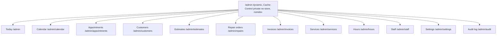
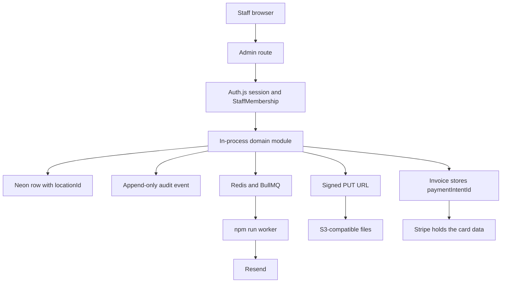
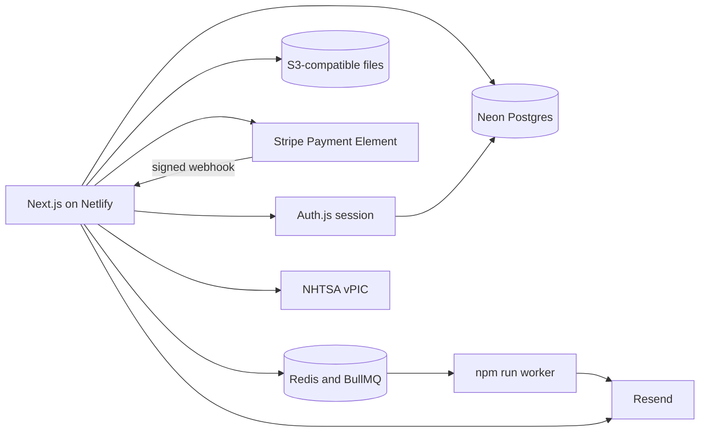

# Berlin AutoWorks

**Reliable repair. Straight answers. Ready for the road.**

Berlin AutoWorks is a fictional full-service auto repair shop in Berlin, New Jersey. This repository holds the product and architecture plan for its website and web app: a public marketing site, a customer portal, and a staff workspace in one modular application.

The launch shop is a single location. Every transactional record carries a location id, so more shops can be added later without rewriting the data model.

The app scaffold lives in this repository. The full specification — sitemap, user flows, rendering strategy, stack, and non-functional requirements — is in [PLANNING.md](docs/PLANNING.md).

## Placeholder shop details

These stand in until real name, address, and phone details are provided.

| | |
| --- | --- |
| Brand | Berlin AutoWorks |
| Address | 123 Route 73, Berlin, NJ 08009 |
| Phone | (856) 555-0147 |
| Email | service@berlinautoworks.example |
| Hours | Mon–Fri 8:00 AM–6:00 PM; Sat 8:00 AM–3:00 PM; Sunday closed |

## What a customer can do

- Book service as a guest or from an account
- Request an estimate, then approve it, decline it, or ask for changes
- Follow a repair from intake through pickup
- Pay an invoice
- Keep vehicles and service history on file

## Surfaces

Three surfaces share one codebase and one API boundary.

| Surface | Who it is for | Auth | Primary goal |
| --- | --- | --- | --- |
| Public site | Prospects and drivers | None | Build trust and convert to a booking or estimate |
| Customer portal (`/account`) | Existing customers | Required | Book, approve estimates, track repairs, pay invoices |
| Staff workspace (`/admin`) | Advisors, technicians, managers | Required, with roles | Run the day: schedule, estimates, repair orders, invoices |

**Public pages:** home, services, about, fleet, contact, book, estimate request, privacy, terms, and accessibility.

**Customer portal:** dashboard, vehicles, appointments, estimates, repair orders, invoices, profile, and security.

**Staff workspace:** operations dashboard, calendar, appointments, customers, estimates, repair orders, invoices, service catalog, hours, staff, settings, and an audit log. Launch roles are service advisor, technician, and manager/owner.

The route map follows that nav. Every `/admin` route is dynamic, sent with `Cache-Control: private, no-store`, and marked noindex. Auth.js already requires a session, and `/admin` also requires a `StaffMembership` for that email. Role access, the advisor’s day, and repair statuses are in [PLANNING.md](docs/PLANNING.md) section 1.4.1. Staff list pages past that gate do not load or change shop records yet.





The staff diagram is the target write path. These calls are connected today: public shop and catalog reads, guest booking and estimate saves, optional photos, Auth.js, and payment of an owned open invoice.



## Services

Preventive maintenance and oil changes, diagnostics, brakes, tires and alignment, battery / starter / alternator, suspension and steering, engine and transmission, HVAC, exhaust, pre-purchase inspection prep, and fleet maintenance.

## Architecture

Launch is a modular monolith, not a set of microservices. A missing secret leaves that feature quiet. The build still succeeds.

| Layer | Choice |
| --- | --- |
| App | Next.js (App Router) and TypeScript on Netlify |
| UI | React, with accessible primitives |
| Data | Neon Postgres via Prisma |
| Cache and jobs | Redis and BullMQ. `npm run worker` is a separate process |
| Files | S3-compatible object storage. The app stores metadata only |
| Payments | Stripe Payment Element. Card data stays with Stripe |
| Email | Resend. The request sends it when `REDIS_URL` is unset |
| Auth | Auth.js credentials. The session cookie is `httpOnly` and `sameSite: lax` |
| Vehicle catalog | NHTSA vPIC through `/api/vehicle-catalog` |

`App --> Email` in the diagram above is that no-Redis fallback. Netlify does not run the worker.

Public marketing pages use incremental static regeneration. Booking and estimate pages stay dynamic so availability is fresh. Customer and staff pages are private, uncached, and excluded from search indexes.

Domain modules, called in-process: identity, locations, catalog, scheduling, estimates, repairs, billing, customers, notifications, audit, and files.

## Launch scope

**In the first version**

- Marketing pages and a service catalog
- Guest and account booking
- Estimate request, staff composition, and a customer decision
- Repair-status timeline and staff photo upload
- Invoices and payment of the full balance
- Vehicles and history
- Staff calendar and day-to-day operations screens
- Email notifications, role-based access, an audit log, backups, and basic observability

**Later**

Multi-location UI, a fleet portal, SMS-first notifications, partial payments, financing, inventory, accounting sync, a blog, native apps, and live chat.

## Repository

| Path | Purpose |
| --- | --- |
| [docs/PLANNING.md](docs/PLANNING.md) | Sitemap, flows, rendering, stack, and acceptance criteria |
| [README.md](README.md) | This overview |
| [docs/systems-engineering/](docs/systems-engineering/README.md) | ConOps, requirements (SRS), architecture, interfaces (ICD), traceability matrix, V&V plan, and risk register |
| `src/app/` | Public site, `/account`, `/admin`, and auth routes |
| `src/modules/` | In-process domain modules |
| [prisma/schema.prisma](prisma/schema.prisma) | Location-aware data model |

## Run the app

```bash
npm install
npm run dev
```

Open [http://localhost:3000](http://localhost:3000). Public pages render from launch copy when `DATABASE_URL` is unset. Copy `.env.example` to `.env` for the pooled Neon URL, `AUTH_SECRET`, and the optional Redis, Resend, S3, and Stripe variables. Booking and estimate requests are saved when the database is set. Sign-in starts when `AUTH_SECRET` is set too.

```bash
npm run typecheck
npm run lint
```

## Status

The three surfaces render. Shop copy and the published catalog read from Neon. Guest booking and estimate requests are stored. Auth.js gates `/account` and `/admin` when `AUTH_SECRET` is set. Redis, Resend, S3, and Stripe run when their variables are set. Staff screens past the sign-in gate, repair timelines, and the audit log are still placeholders.
