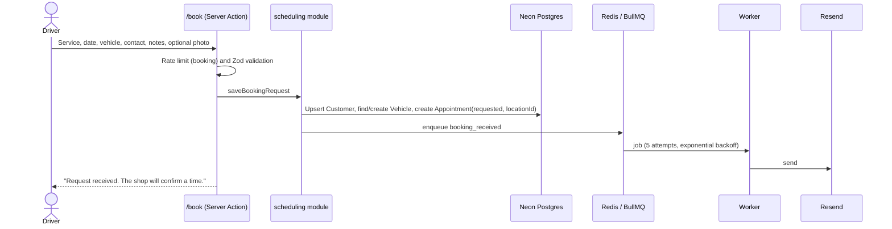
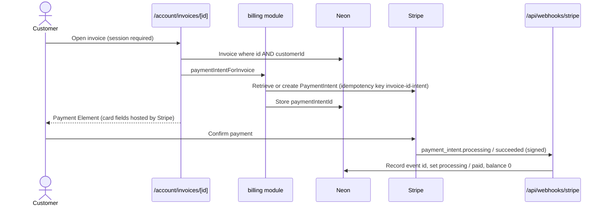
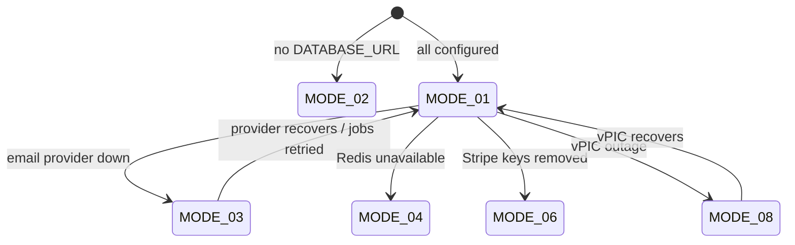

# 01 — Concept of Operations (ConOps)

**System:** Berlin AutoWorks web application (public site, customer portal, staff workspace)
**Baseline:** 2026-11-10, code `5ba429c`
**Related:** [02 SRS](02-system-requirements-specification.md) · [03 Architecture](03-system-architecture-design.md)

## 1. Purpose and scope

Berlin AutoWorks is a single-location, full-service auto repair shop in Berlin,
New Jersey (placeholder business). The system replaces phone-and-paper
handoffs between the driver and the shop with one web application that covers
the whole repair lifecycle: discovery → booking → estimate → repair → invoice →
payment → history.

The system is a **modular monolith** (see [ADR-01](03-system-architecture-design.md#8-architecture-decision-records)).
It is location-aware from day one so a second shop can be added without a data
migration, but the launch user interface assumes one active location.

### 1.1 In scope (launch)

Public marketing pages and service catalog; guest and account booking;
estimate request, staff composition, and customer decision; customer-safe
repair status; invoices with full-balance card payment; vehicles and history;
staff day-to-day screens; email notifications; role-based access; audit log;
backups and basic observability.

### 1.2 Out of scope (launch)

Multi-location UI, fleet portal, SMS-first notifications, partial payments,
financing, inventory and purchasing, accounting sync beyond export, blog/CMS,
native apps, live chat, real-time bay boards.

## 2. Stakeholders

| ID | Stakeholder | Interest | Interaction surface |
| --- | --- | --- | --- |
| STK-01 | Prospect / driver | Trust the shop, find a service, get a time or a price | Public site (`/`) |
| STK-02 | Customer (account holder) | Track their car, decide on estimates, pay, keep history | Customer portal (`/account`) |
| STK-03 | Service advisor | Run the day: schedule, estimates, repair orders, invoices | Staff workspace (`/admin`) |
| STK-04 | Technician | Update assigned repair orders, notes, photos | Staff workspace (`/admin/repairs`) |
| STK-05 | Manager / owner | Staff, hours, catalog, settings, audit, refunds; business health | Staff workspace (all) |
| STK-06 | Fleet account contact | Repeatable service for work vehicles (B2B) | Public `/fleet` landing; portal later |
| STK-07 | Operator / developer | Deploy, configure, monitor, recover | Netlify, Neon, Redis, worker host, provider dashboards |
| STK-08 | Payment provider (Stripe) | Correct, signed, idempotent payment lifecycle | `IF-03`, `IF-04` |
| STK-09 | Regulators / legal | NJ consumer auto-repair notices, privacy, accessibility | Published policies, estimate/invoice disclosures |
| STK-10 | Search engines | Accurate, crawlable, non-duplicated public content | `sitemap.xml`, `robots.txt`, public HTML |

## 3. Stakeholder needs

Needs are in the problem space ("what the stakeholder must be able to do").
Each need is refined into system requirements in [02](02-system-requirements-specification.md).

| ID | Need | Stakeholders | Priority |
| --- | --- | --- | --- |
| SN-01 | Learn what the shop does, where it is, and when it is open, and trust it | STK-01, STK-10 | Must |
| SN-02 | Request a service appointment without creating an account | STK-01 | Must |
| SN-03 | Get a written estimate and approve, decline, or ask for changes before work starts | STK-01, STK-02, STK-03 | Must |
| SN-04 | See where the repair is without calling the shop | STK-02 | Must |
| SN-05 | Pay an invoice online, safely, without the shop handling card data | STK-02, STK-08 | Must |
| SN-06 | Keep vehicles and service history on file and re-book from them | STK-02 | Should |
| SN-07 | Run the shop day from one screen: arrivals, approvals, repair status, pickups | STK-03, STK-04 | Must |
| SN-08 | Control who can see and change what, and see who did it | STK-05 | Must |
| SN-09 | Add a second location later without rewriting the data model | STK-05, STK-07 | Must |
| SN-10 | Keep customer data private and payment data out of scope for PCI | STK-02, STK-08, STK-09 | Must |
| SN-11 | Use the site with a keyboard, screen reader, or phone | STK-01, STK-02, STK-09 | Must |
| SN-12 | Keep the system available, observable, and recoverable | STK-07, STK-05 | Must |
| SN-13 | Keep taking bookings when a third-party provider is missing or down | STK-01, STK-03, STK-07 | Must |
| SN-14 | Show required NJ consumer disclosures on estimates and invoices | STK-09 | Should |
| SN-15 | Change, extend, and release the system safely with a small team | STK-07 | Must |

## 4. Operational scenarios

Each scenario maps to a PLANNING.md user flow (A–F). The happy path is first;
key exceptions follow.

### OS-01 — Prospect researches the shop (SN-01)

1. Driver arrives from search on `/` or `/services/<slug>`.
2. The page renders shop name, address, phone, and email from the active
   `Location` row and the published service catalog.
3. Driver reads a service detail and chooses **Book service** or
   **Request an estimate**.

*Exceptions:* unknown slug → 404 page; database not configured → in-repo launch
copy is served so the site still renders.

### OS-02 — Guest books a service (Flow A; SN-02, SN-13)

*Exceptions:* rate limited → "Too many attempts"; validation error → field
errors; email provider down → appointment still saved (MODE-03); photo attach
fails → booking kept without photo; no slots or outside hours → *not yet
implemented* (SR-BOOK-004).

### OS-03 — Estimate request, composition, and decision (Flow B; SN-03)

1. Driver submits `/estimate` (concern, vehicle, contact, optional photo).
2. System creates an `Estimate` in `draft` scoped to the location and sends
   `estimate_received`.
3. Advisor composes line items and sends (`sent`). *Not yet implemented.*
4. Customer approves, declines, or requests changes on `/account/estimates/<id>`.
   *Not yet implemented.*
5. On approval the estimate locks; a repair order can be created.

*Exceptions:* decline → `declined`; change request → `changes_requested`, a new
revision keeps history; TTL elapsed → `expired`; price change after approval
→ re-approval before more work.

### OS-04 — Customer follows a repair (Flow C; SN-04)

1. Advisor creates a `RepairOrder` from an approved estimate or a walk-in.
2. Status moves through `intake → diagnosis → waiting_parts → in_progress →
   quality_check → ready → delivered` (plus `on_hold`, `cancelled`).
3. Customer sees a customer-safe timeline and `visibility=customer` photos.
   Internal notes never appear.
4. On `ready`, the customer is prompted to pick up and pay.

### OS-05 — Customer pays an invoice (Flow D; SN-05)

*Exceptions:* invoice not owned → 404; already paid → message; draft/void →
"not ready to pay"; payment fails → invoice stays `open`; webhook delayed →
`processing` shown; duplicate webhook → acknowledged, not re-applied.

### OS-06 — Customer manages account, vehicles, history (Flow E; SN-06)

Sign up → confirm the email from the verification link (records made earlier under that email attach only then) → `/account` dashboard (upcoming appointments, open
estimates, unpaid invoices) → vehicles list → vehicle detail with its
appointments → re-book with vehicle prefilled (*re-book not yet implemented*).
Password reset uses a single-use, one-hour, hashed token and revokes existing
sessions.

### OS-07 — Advisor's day (Flow F; SN-07)

Open `/admin` (Today) → check in arrivals → create/link repair order → send
estimate → watch approvals → move status → close and invoice → confirm payment
and pickup. *The admin gate is implemented; the screens past it are
placeholders.*

### OS-08 — Owner administers the shop (SN-08)

Manage staff memberships and roles, hours and blackout dates, the service
catalog (with on-demand revalidation of public pages), settings, and review
the audit log. *Not yet implemented.*

### OS-09 — Operator deploys and recovers (SN-12)

Deploy web app to Netlify on merge; run Prisma migrations against the direct
Neon URL; run `npm run worker` on a long-running host; restore from Neon
point-in-time recovery when needed; rotate a secret by updating the
environment and redeploying.

## 5. System modes

The application keeps running when an optional integration is absent. A
missing secret disables that feature, never the build
([ADR-06](03-system-architecture-design.md#8-architecture-decision-records)).

| ID | Mode | Trigger | Behaviour |
| --- | --- | --- | --- |
| MODE-01 | Full operation | All variables set, worker running | All implemented features active |
| MODE-02 | Preview / no database | `DATABASE_URL` unset | Public pages render from in-repo launch copy; forms report "not configured"; nothing is saved |
| MODE-03 | Degraded: no email | `RESEND_API_KEY` or `EMAIL_FROM` unset, or provider failing | Records saved; email skipped or retried; password reset reports "not configured" |
| MODE-04 | Degraded: no Redis | `REDIS_URL` unset | Rate limits are in-memory per instance; email sent inline on the request |
| MODE-05 | Degraded: no auth | `AUTH_SECRET` unset | `/account` and `/admin` render with a preview banner and load no records; `/api/auth/*` returns 503 |
| MODE-06 | Degraded: no payments | Stripe keys unset | Invoice balance shown; no Payment Element; webhook returns 400 |
| MODE-07 | Degraded: no file storage | S3 variables unset | Photo upload disabled; forms still submit |
| MODE-08 | Degraded: vPIC down | NHTSA API failing | `/api/vehicle-catalog/*` returns 502; make/model pickers cannot load |

## 6. Operational environment

| Element | Launch assumption |
| --- | --- |
| Users | Tens of concurrent staff; hundreds of daily customer sessions |
| Devices | Phone-first for public and customer surfaces; desktop/tablet for staff |
| Time zone | Location timezone, default `America/New_York` |
| Hours | Mon–Fri 8:00–18:00; Sat 8:00–15:00; Sun closed |
| Hosting | Netlify (web), separate long-running host for the worker, Neon Postgres, managed Redis, S3-compatible bucket |
| Connectivity | Public internet; all traffic HTTPS |

## 7. Constraints

- Card numbers and CVC never touch application servers (PCI SAQ-A posture).
- Every transactional record carries `locationId`.
- Customer and staff pages are dynamic, `Cache-Control: private, no-store`, and noindex.
- Next.js App Router only; no Pages Router. TypeScript strict; no `any`.
- No microservices at launch; background work runs in a worker that shares the modules.
