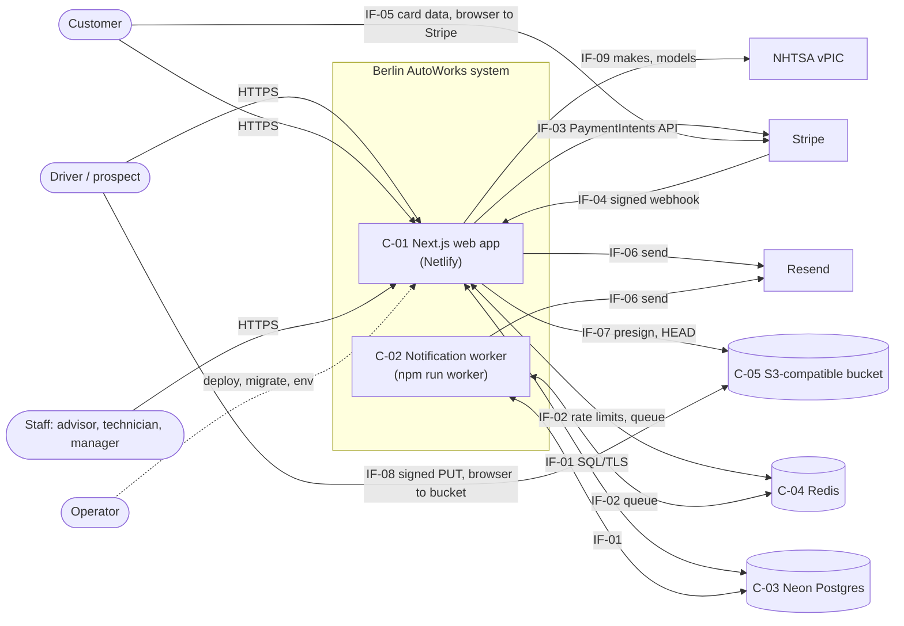
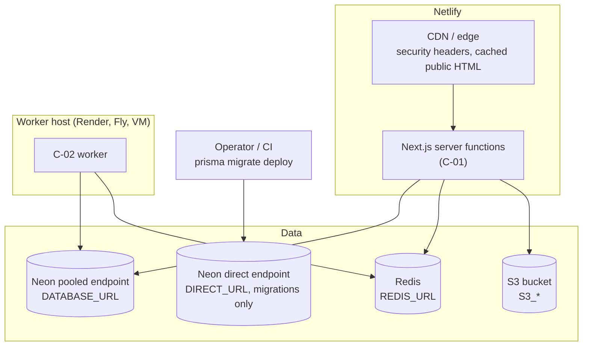
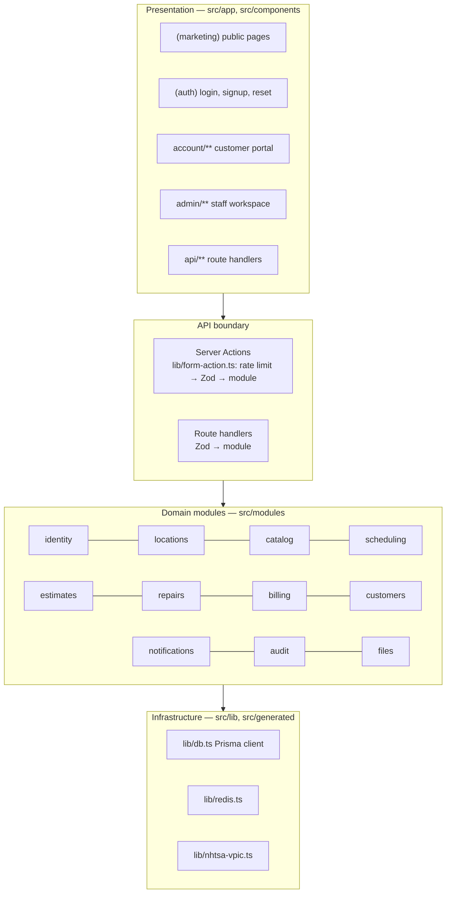
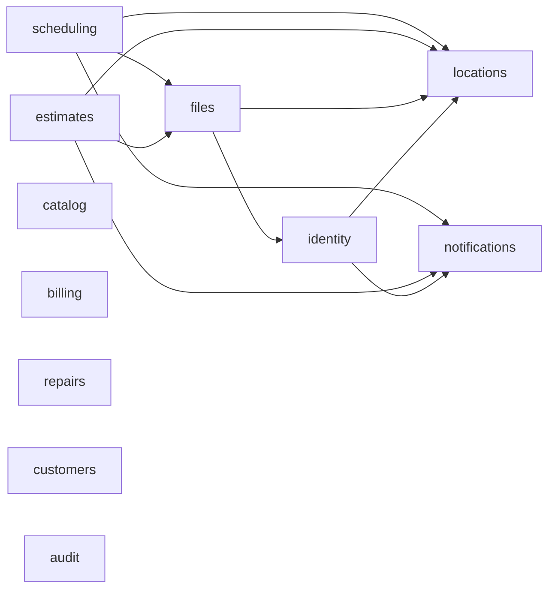
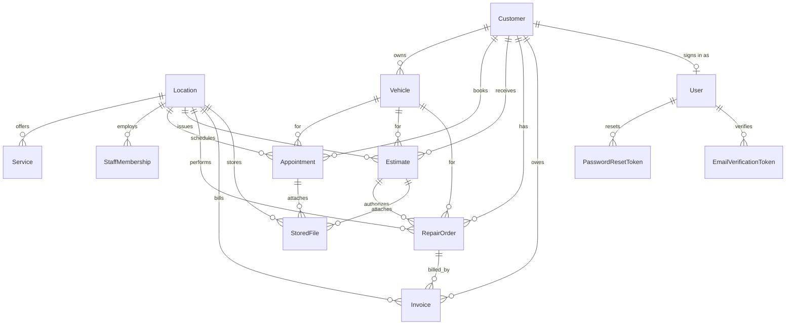
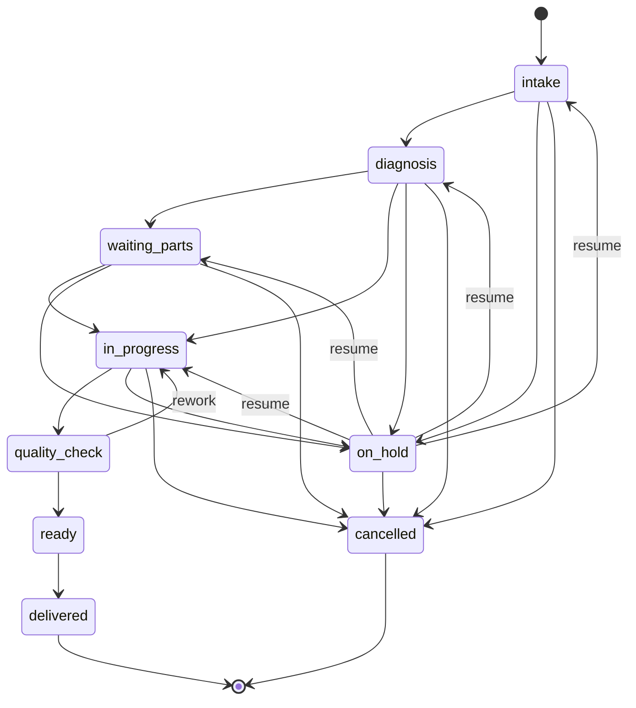
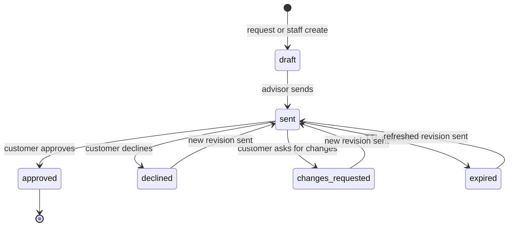
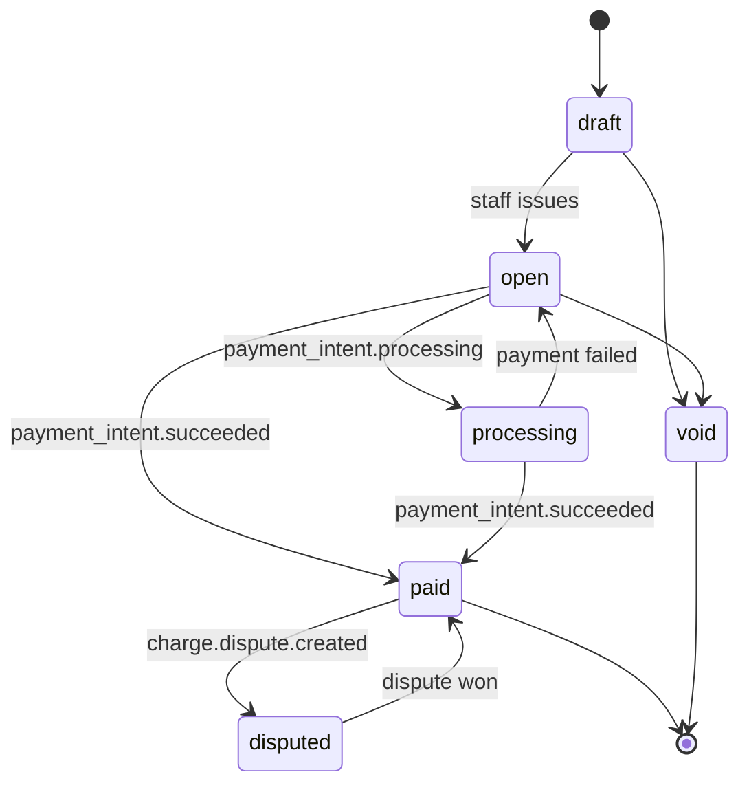
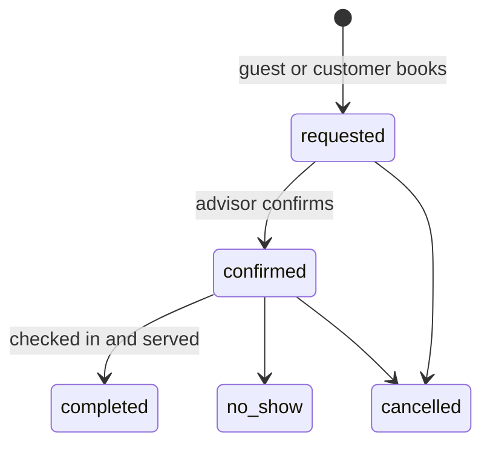
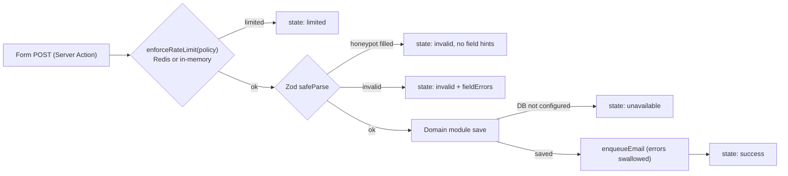

# 03 — System Architecture and Design Description

**System:** Berlin AutoWorks web application
**Baseline:** 2026-11-10, code `5ba429c`
**Related:** [02 SRS](02-system-requirements-specification.md) · [04 ICD](04-interface-control-document.md) · [05 RTM](05-requirements-traceability-matrix.md)

## 1. Architectural drivers

The architecture is shaped mainly by these requirements:

| Driver | Requirements | Architectural response |
| --- | --- | --- |
| One small team, one shop, fast iteration | SN-07, NFR-MNT-003 | Modular monolith with in-process domain modules ([ADR-01](#adr-01--modular-monolith)) |
| Grow to more locations without rewrite | SN-09, SR-LOC-001..003 | `locationId` on every transactional row; staff access as per-location membership ([ADR-02](#adr-02--location-scoped-data-from-day-one)) |
| Payment data out of PCI scope | SR-BIL-003, NFR-SEC-007 | Stripe Payment Element; app stores intent id only ([ADR-04](#adr-04--hosted-payment-element-and-webhook-as-source-of-truth)) |
| Keep taking bookings when a provider fails | SN-13, NFR-REL-006/007 | Every integration is optional and checked per call ([ADR-06](#adr-06--every-integration-is-optional)) |
| Fast, indexable public site; private portals | NFR-PERF-001, NFR-SEC-004, NFR-RND-* | Cache Components with named `cacheLife` profiles for public; `connection()` + `no-store` for private ([ADR-05](#adr-05--rendering-split-by-surface)) |
| Slow I/O off the request path | NFR-REL-005 | Redis + BullMQ queue with a separate worker process ([ADR-03](#adr-03--queue-with-a-separate-worker-and-an-inline-fallback)) |

## 2. System context

Card data (IF-05) and photo bytes (IF-08) go **directly from the browser to
the provider**; neither passes through `C-01`.

## 3. Physical (runtime) components

| ID | Component | Technology | Runs on | Responsibility | Statefulness |
| --- | --- | --- | --- | --- | --- |
| C-01 | Web application | Next.js 16 App Router, React 19, TypeScript | Netlify (Node 20) | All HTTP: pages, Server Actions, route handlers, webhooks | Stateless (in-memory rate-limit fallback only) |
| C-02 | Notification worker | Node + `tsx src/worker.ts`, BullMQ | Long-running host (not Netlify) | Consume `notifications` queue, send email | Stateless |
| C-03 | Database | Neon Postgres via Prisma 7 + `@prisma/adapter-pg` | Neon (pooled for app, direct for migrate) | System of record | Durable |
| C-04 | Cache / queue | Redis (ioredis), BullMQ | Managed Redis | Rate-limit counters, job queue | Ephemeral |
| C-05 | Object storage | S3 API (AWS S3, R2, MinIO) | Provider | Photo bytes | Durable |
| C-06 | Payment provider | Stripe | SaaS | Card capture, payment state | External |
| C-07 | Email provider | Resend | SaaS | Transactional email delivery | External |
| C-08 | Vehicle catalog | NHTSA vPIC public API | Government SaaS | Makes and models | External |

### 3.1 Deployment view

**Constraint:** Netlify does not run long-lived processes. If `REDIS_URL` is
set on Netlify, a worker **must** run elsewhere or queued email will never be
delivered (RSK-07).

### 3.2 Configuration items

| Variable | Used by | Feature gated | Required for build |
| --- | --- | --- | --- |
| `DATABASE_URL` | C-01, C-02, seed | All persistence | No |
| `DIRECT_URL` | Prisma Migrate | Migrations | No |
| `NEXT_PUBLIC_SITE_URL` | C-01 | Canonical URLs, sitemap, email links | No (defaults to localhost) |
| `AUTH_SECRET`, `AUTH_URL` | C-01 | Sign-in, `/account`, `/admin` | No |
| `REDIS_URL` | C-01, C-02 | Shared rate limits, queued email | No |
| `RESEND_API_KEY`, `EMAIL_FROM` | C-01, C-02 | Email | No |
| `STRIPE_SECRET_KEY`, `STRIPE_WEBHOOK_SECRET`, `NEXT_PUBLIC_STRIPE_PUBLISHABLE_KEY` | C-01 | Payments | No |
| `S3_BUCKET`, `S3_REGION`, `S3_ACCESS_KEY_ID`, `S3_SECRET_ACCESS_KEY`, `S3_ENDPOINT` | C-01 | Photo upload | No |

## 4. Logical decomposition

### 4.1 Layers

Rule: presentation never talks to infrastructure for writes; it calls a
module. (Portal *read* pages currently call `getDb()` directly with a
`customerId` filter — acceptable for reads, but see the note in §4.3.)

### 4.2 Domain modules

| ID | Module | Path | Responsibility | Owns (tables) | Status |
| --- | --- | --- | --- | --- | --- |
| M-IDN | identity | `src/modules/identity` | Credentials, password hashing, sessions, reset and email verification tokens, roles/capabilities, rate limits, `requireCustomer` / `requireStaff` | `User`, `PasswordResetToken`, `EmailVerificationToken`, `StaffMembership` (read) | Implemented core; RBAC per-route pending |
| M-LOC | locations | `src/modules/locations` | Active location, public shop profile, hours | `Location` | Implemented (hours in code) |
| M-CAT | catalog | `src/modules/catalog` | Published services, fallback catalog | `Service` | Read path implemented; admin CRUD pending |
| M-SCH | scheduling | `src/modules/scheduling` | Booking schema, save booking, visit display | `Appointment` | Request intake implemented; capacity pending |
| M-EST | estimates | `src/modules/estimates` | Estimate request schema and save | `Estimate` | Request intake implemented; compose/decide pending |
| M-REP | repairs | `src/modules/repairs` | RO statuses, customer-safe view type | `RepairOrder` | Types only |
| M-BIL | billing | `src/modules/billing` | Payment intents, Stripe webhook application | `Invoice`, `StripeEvent` | Payment implemented; invoicing pending |
| M-CUS | customers | `src/modules/customers` | Customer/staff scope types | `Customer`, `Vehicle` | Types only (writes happen in M-SCH/M-EST/M-IDN) |
| M-NTF | notifications | `src/modules/notifications` | Templates, enqueue, deliver, worker | — (Redis) | Implemented |
| M-AUD | audit | `src/modules/audit` | Audit action vocabulary and event shape | — (none yet) | Types only |
| M-FIL | files | `src/modules/files` | Signed upload, attach, visibility | `StoredFile` | Implemented |

### 4.3 Module dependency graph (as built)

Observations:

- `files` depends on `identity` only for `createToken`/`hashToken`; these are
  generic crypto helpers and could move to `src/lib`.
- `scheduling` and `estimates` both upsert `Customer` and find-or-create
  `Vehicle` with duplicated code. That logic belongs in `customers` (M-CUS) —
  and is where the RSK-02 fix should live.
- `billing` writes an audit line to stdout directly instead of calling `audit`.
  When `audit` gains persistence, billing should call it.

### 4.4 Allocation of functional areas to components and modules

| Area | Module(s) | Component(s) | Interfaces |
| --- | --- | --- | --- |
| PUB | M-CAT, M-LOC | C-01, C-03 | IF-01 |
| BOOK | M-SCH, M-FIL, M-NTF | C-01, C-02, C-03, C-04, C-05 | IF-01, IF-02, IF-06, IF-07, IF-08, IF-09 |
| EST | M-EST, M-FIL, M-NTF | C-01, C-02, C-03, C-04, C-05 | IF-01, IF-02, IF-06, IF-07, IF-08 |
| REP | M-REP, M-FIL, M-NTF | C-01, C-03 | IF-01 |
| BIL | M-BIL | C-01, C-03, C-06 | IF-01, IF-03, IF-04, IF-05 |
| CUS | M-CUS | C-01, C-03, C-08 | IF-01, IF-09 |
| IDN | M-IDN | C-01, C-03, C-04 | IF-01, IF-02, IF-06, IF-10 |
| ADM | all | C-01, C-03 | IF-01 |
| AUD | M-AUD | C-01, C-03 | IF-01 |
| FIL | M-FIL | C-01, C-03, C-05 | IF-07, IF-08 |
| NTF | M-NTF | C-01, C-02, C-04, C-07 | IF-02, IF-06 |
| LOC | M-LOC | C-01, C-03 | IF-01 |

## 5. Surfaces and route map

| Surface | Base | Gate | Rendering | Headers |
| --- | --- | --- | --- | --- |
| Public | `/` | None | Cache Components; `cacheLife` `marketing` / `contact` / `legal` | Security headers |
| Auth | `/login`, `/signup`, `/forgot-password`, `/reset-password`, `/verify-email` | None | Dynamic | + `private, no-store`, noindex |
| Customer portal | `/account/**` | `requireCustomer()` → redirect `/login` | Dynamic (`connection()`) | + `private, no-store`, noindex |
| Staff workspace | `/admin/**` | `requireStaff()` → redirect `/login` or `forbidden()` | Dynamic (`connection()`) | + `private, no-store`, noindex |
| API | `/api/**` | Per handler | Dynamic | Security headers |

Full route list: [PLANNING.md §1.2–1.4](../PLANNING.md#1-sitemap-and-user-flows).

## 6. Data architecture

### 6.1 Entity relationships

`StripeEvent` stands alone (primary key = Stripe event id) as the webhook
dedup ledger. `StaffMembership` is matched to `User` by email, not by foreign
key ([ADR-07](#adr-07--staff-access-by-email-matched-membership)).

### 6.2 Data classification

| Class | Examples | Handling |
| --- | --- | --- |
| Public | Service copy, shop NAP, hours | Cached at the edge |
| Customer-confidential | Name, email, phone, vehicles, appointments, estimates, invoices, `customerSummary`, `visibility=customer` files | Only to the owning customer (by `customerId`) or staff at the location |
| Staff-internal | `internalNotes`, `visibility=internal` files, audit events | Never selected by a portal query |
| Secret | `passwordHash`, `tokenVersion`, reset and verification `tokenHash`, `uploadTokenHash`, env secrets | Never rendered; hashes only |
| Out of scope | Card PAN, CVC | Never present — held by Stripe |

### 6.3 Concurrency control

`Appointment`, `Estimate`, `RepairOrder`, and `Invoice` carry an integer
`version` for optimistic locking. The intended write pattern is
`update … where { id, version } data { …, version: { increment: 1 } }` and a
conflict UI on zero rows updated. Today only the Stripe webhook increments
`version`; it does not condition on it.

## 7. Behaviour

### 7.1 Repair order state machine (SR-REP-002)

> **Design decision needed (open):** PLANNING.md §1.4.1 draws the linear chain
> without a resume path out of `on_hold`, a `diagnosis → in_progress` skip, or
> a `quality_check` rework loop. The diagram above proposes them. Confirm
> before implementing the transition guard (tracked as RSK-16).

### 7.2 Estimate state machine (SR-EST-004..009)

A new revision increments `revision`; an approved revision is never edited.

### 7.3 Invoice state machine (SR-BIL-*)

Implemented transitions: `open/processing → processing` and
`open/processing → paid` (webhook). Others are planned.

### 7.4 Appointment state machine

### 7.5 Request pipeline for a public form

## 8. Architecture decision records

### ADR-01 — Modular monolith

- **Status:** Accepted
- **Context:** One shop, one small team, launch scope is a few CRUD-heavy flows.
- **Decision:** One Next.js deployable with in-process modules under `src/modules`; a worker process reuses the same modules.
- **Consequences:** Simple deployment and transactions. Module boundaries are by convention, not enforced; consider an ESLint import rule. Rejected: per-domain microservices, GraphQL federation.

### ADR-02 — Location-scoped data from day one

- **Status:** Accepted
- **Decision:** `locationId` on every transactional table; staff access as `StaffMembership(locationId, email, role)`.
- **Consequences:** No migration needed for location two. Today `getActiveLocation()` returns the oldest active row, which becomes ambiguous once two exist (RSK-11).

### ADR-03 — Queue with a separate worker and an inline fallback

- **Status:** Accepted
- **Decision:** BullMQ on Redis for email; `npm run worker` consumes. Without `REDIS_URL`, send inline.
- **Consequences:** Request latency stays low with Redis; the worker must be hosted outside Netlify (RSK-07). Jobs lack an idempotency key (RSK-06).

### ADR-04 — Hosted Payment Element and webhook as source of truth

- **Status:** Accepted
- **Decision:** Stripe Payment Element in the browser; server creates PaymentIntents with `metadata.invoiceId`; invoice reaches `paid` only through a signed webhook; `StripeEvent` dedups.
- **Consequences:** SAQ-A scope; no false "paid". Webhook ordering bug (RSK-08) must be fixed by making dedup and state change one transaction.

### ADR-05 — Rendering split by surface

- **Status:** Accepted
- **Decision:** `cacheComponents: true`. Public data functions use `"use cache"` with named `cacheLife` profiles; private layouts call `connection()`; `next.config.ts` adds `private, no-store` and `noindex` headers to private routes.
- **Consequences:** CDN-fast public pages; personalised HTML never cached. On-demand revalidation from admin writes still to be added (SR-ADM-006).

### ADR-06 — Every integration is optional

- **Status:** Accepted
- **Decision:** Each integration has an `xConfigured()` check; missing config yields a user-safe message and no crash; the build needs no secrets.
- **Consequences:** Easy local dev and previews (MODE-02..08). Risk of silently running in a degraded mode in production — add a startup/health report of which integrations are active (NFR-OBS).

### ADR-07 — Staff access by email-matched membership

- **Status:** Accepted
- **Decision:** One `User` table for staff and customers. Staff authority comes from a `StaffMembership` row with the same email (case-insensitive) at the active location.
- **Consequences:** Staff can be provisioned before they sign up. Because the match is by email, `requireStaff()` honours a membership only after the user has verified that email (SR-IDN-007); without that check, anyone who registered a staff member's email first would gain staff access (RSK-01, mitigated).

### ADR-08 — JWT sessions with a revocation counter

- **Status:** Accepted
- **Decision:** Auth.js JWT strategy; each request re-reads `User.tokenVersion` and rejects stale tokens.
- **Consequences:** Password reset revokes all sessions without a session table. Costs one DB read per authenticated request.
