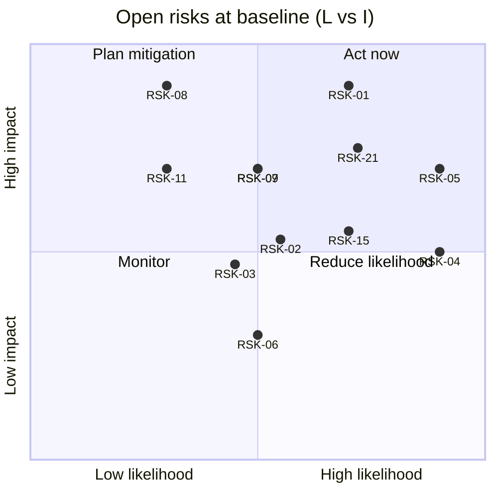

# 07 — Risk and Hazard Register

**System:** Berlin AutoWorks web application
**Baseline:** 2026-11-10, code `5ba429c`
**Related:** [02 SRS](02-system-requirements-specification.md) · [05 RTM §6](05-requirements-traceability-matrix.md#6-risk-linkage) · [06 V&V](06-verification-validation-plan.md)

## 1. Method

- **Likelihood (L)** and **Impact (I)** on 1–5. **Score = L × I.**
- **Rating:** 15–25 **High** · 8–14 **Medium** · 1–7 **Low**.
- Risks found by code inspection cite the file and the test case that will
  prove the fix. A risk is closed only when that test passes in CI.
- IDs are never reused. Closed risks stay in the table with the closing commit.

## 2. Register

### 2.1 Security and privacy

| ID | Risk | Cause / evidence | L | I | Score | Rating | Mitigation | Verify by | Owner | Status |
| --- | --- | --- | --- | --- | --- | --- | --- | --- | --- | --- |
| RSK-01 | **Unverified email grants access to someone else's records and to staff access.** A person who signs up with an email they do not own sees every appointment, estimate, and invoice that a guest created under it; if that email has a `StaffMembership`, they get `/admin`. | `registerCustomer` (`identity/accounts.ts`) upserts `Customer` by email and links the new `User`; `requireStaff` matches membership by email; `/verify-email` is a placeholder; no verification gate. | 4 | 5 | 20 | **High** | Require email verification (signed, single-use token) before (a) linking `User.customerId` to an existing `Customer` and (b) honouring a `StaffMembership`. Until then, create a fresh `Customer` on signup and keep the staff workspace disabled in production. | TC-BOOK-012, TC-IDN-011 with unverified staff email | Eng | Open |
| RSK-02 | **Unauthenticated forms overwrite an existing customer's profile and inject records into their portal.** Anyone who knows a customer's email can change their stored name and phone and add appointments/estimates to their account. | `saveBookingRequest` and `saveEstimateRequest` call `customer.upsert({ where: { email }, update: { name, phone } })`. | 3 | 3 | 9 | Medium | Do not update an existing customer from a guest form; store guest contact on the `Appointment`/`Estimate` (already captured as `guestName/guestEmail/guestPhone`) and link to the customer only after staff review or a verified claim. Move the shared customer/vehicle logic into `M-CUS`. | TC-PRIV-003 | Eng | Open |
| RSK-03 | **Rate limits can be bypassed or are ineffective.** | Key is the first `X-Forwarded-For` entry, which a client can set if the platform appends rather than replaces it. Without Redis, limits live in one serverless instance's memory and reset on cold start. Login is limited per IP only, so credential stuffing across IPs is not slowed per account. | 3 | 3 | 9 | Medium | Use the platform's trusted client-IP header (Netlify `x-nf-client-connection-ip`); require `REDIS_URL` in production; add a per-account login limiter and lockout (SR-IDN-009); add bot protection on public forms if abuse appears. | TC-IDN-008 with spoofed header | Eng | Open |
| RSK-15 | **Role capabilities not enforced.** A technician can open manager-only admin pages once those pages load data. | `roleHasCapability` (`identity/roles.ts`) is not called by any route or action; `admin/layout.tsx` checks membership only. | 4 | 3 | 12 | Medium | Add `requireCapability(cap)` that calls `requireStaff()` then `forbidden()`; call it in every admin page and action. Add an ESLint/CI check that each `src/app/admin/**/page.tsx` calls it. | TC-IDN-012 | Eng | Open — must close before any admin page reads data |
| RSK-17 | **No Content-Security-Policy.** XSS impact is not reduced. | `next.config.ts` sets no CSP. | 2 | 4 | 8 | Medium | Ship CSP report-only (allow `js.stripe.com`, `*.stripe.com` frames, S3 origin for `connect-src`), then enforce (NFR-SEC-003). | TC-SEC-003 | Eng | Open |

### 2.2 Payments and data integrity

| ID | Risk | Cause / evidence | L | I | Score | Rating | Mitigation | Verify by | Owner | Status |
| --- | --- | --- | --- | --- | --- | --- | --- | --- | --- | --- |
| RSK-08 | **A Stripe event can be lost permanently.** If the invoice update fails after the dedup row is written, Stripe's retry is treated as a duplicate and acknowledged. An invoice paid at Stripe stays `open`. | `applyStripeEvent` (`billing/stripe.ts`) inserts `StripeEvent` before and outside the transaction that updates `Invoice`. | 2 | 5 | 10 | Medium | Run dedup insert and invoice update in one `$transaction`; or insert the dedup row last. Add a nightly reconciliation that lists Stripe `succeeded` intents with `metadata.invoiceId` whose invoice is not `paid`. | TC-BIL-007(b) | Eng | Open |
| RSK-09 | **Payment states drift from Stripe** for failures, refunds, and disputes. | Webhook handles only `processing` and `succeeded`. A failed payment after `processing` leaves the invoice in `processing`; refunds and disputes are not reflected. | 3 | 4 | 12 | Medium | Handle `payment_intent.payment_failed` (→ `open`), `charge.refunded`, `charge.dispute.created/closed` (SR-BIL-010, -011). | TC-BIL-009, TC-BIL-010, TC-BIL-011 | Eng | Open |
| RSK-10 | **Stale PaymentIntent amount** if an invoice total changes after the first intent. | Idempotency key `invoice-<id>-intent` is constant; an existing intent is reused without comparing `amount` to `balanceDueCents`. | 2 | 4 | 8 | Medium | Compare amounts and update or cancel/recreate the intent; include invoice `version` in the idempotency key. Matters once staff can edit invoices. | TC-BIL-005 variant | Eng | Open |
| RSK-12 | **Shop hours shown publicly can disagree with the hours the scheduler uses.** | Hours are launch copy in `locations/profile.ts`, not a `Location` column (SR-PUB-006). | 3 | 2 | 6 | Low | Add hours/blackout tables per location (SR-LOC-003) and read both the public page and scheduler from them. | TC-PUB-006 | Eng | Open |
| RSK-14 | **Optimistic locking not applied.** Concurrent staff edits will silently overwrite each other. | `version` columns exist; no write conditions on them. | 3 | 3 | 9 | Medium | Use `updateMany({ where: { id, version } })` and treat 0 rows as a conflict (SR-EST-009). Establish the helper before building admin writes. | TC-EST-009 | Eng | Open |

### 2.3 Operations and reliability

| ID | Risk | Cause / evidence | L | I | Score | Rating | Mitigation | Verify by | Owner | Status |
| --- | --- | --- | --- | --- | --- | --- | --- | --- | --- | --- |
| RSK-04 | **No audit trail.** Required for staff accountability and refunds (SR-AUD-001). | `audit` module defines types only; one `console.info` line for `invoice.paid`. | 5 | 3 | 15 | **High** | Add an insert-only `AuditEvent` table and `recordAudit(tx, event)` called inside each mutating transaction. Build before admin writes, not after. | TC-AUD-001 | Eng | Open |
| RSK-05 | **No automated verification.** Regressions in auth scoping or payments would ship unnoticed. | No test runner, no CI workflow. 55 implemented requirements have no test. | 5 | 4 | 20 | **High** | Follow [06 §6](06-verification-validation-plan.md#6-recommended-order-of-work): CI first, then unit, integration, E2E. | GATE-01 | Eng | Open |
| RSK-06 | **Email can be lost or duplicated.** | Worker treats a provider rejection (`result.error`) as success, so BullMQ never retries it; a retry after a timeout can send twice (no idempotency key). Inline fallback adds provider latency to the request. | 3 | 2 | 6 | Low | Throw on `result.error` so BullMQ retries; pass a Resend idempotency key (`<template>:<subjectId>`); log `jobId`, template, and subject id. | TC-NTF-001 variant | Eng | Open |
| RSK-07 | **Queued email never sent** if `REDIS_URL` is set on Netlify with no worker running elsewhere. | Netlify cannot run `npm run worker`; README notes it. | 3 | 4 | 12 | Medium | Host the worker (Render/Fly/VM) as part of GATE-06; alert on queue depth > N for > 10 min; document in a runbook. | GATE-06 | Ops | Open |
| RSK-11 | **Wrong location when a second one is added.** | `getActiveLocation()` returns the oldest active location; every save and the staff gate use it. | 2 | 4 | 8 | Medium | Resolve location from the request (host, path, or staff membership) before activating location two; forbid two active locations until then (DB check or startup assertion). | TC-LOC-002 variant | Eng | Open (latent) |
| RSK-13 | **Orphan uploads accumulate** in the bucket and `StoredFile` table. | Signing creates a row and URL; nothing removes files never attached. | 3 | 1 | 3 | Low | Daily job deletes unattached files older than 24 h (SR-FIL-007); bucket lifecycle rule on `locations/*/uploads/` as a backstop. | TC-FIL-007 | Eng | Open |
| RSK-18 | **Silent degraded mode in production.** A missing secret disables a feature without anyone noticing (ADR-06). | `*Configured()` guards return quietly by design. | 3 | 3 | 9 | Medium | Health endpoint (staff-only or token) listing which integrations are configured; alert if production reports any as missing. | NFR-OBS-004 | Ops | Open |
| RSK-19 | **No observability or alerting** for 5xx, webhook failures, queue backlog, backup failures. | NFR-OBS-002..004 not started. | 4 | 3 | 12 | Medium | Error tracker with release tags; structured logger with `requestId`, `locationId`; alerts per NFR-OBS-004. | GATE-06 | Ops | Open |
| RSK-20 | **Dependency on NHTSA vPIC** availability for the make/model pickers. | Booking and estimate forms need vPIC for make/model choices. | 2 | 3 | 6 | Low | Allow free-text make/model when the proxy returns 502; keep 24 h cache. | TC-MODE-08 | Eng | Open |

### 2.4 Scope and delivery

| ID | Risk | Cause / evidence | L | I | Score | Rating | Mitigation | Verify by | Owner | Status |
| --- | --- | --- | --- | --- | --- | --- | --- | --- | --- | --- |
| RSK-16 | **Repair-order state machine is under-specified.** No resume path from `on_hold`, no rework loop, no skip of `waiting_parts`. | PLANNING.md §1.4.1 draws a strict chain; real shop flow needs the extra edges. | 4 | 2 | 8 | Medium | Approve the proposed machine in [03 §7.1](03-system-architecture-design.md#71-repair-order-state-machine-sr-rep-002) with the shop manager before building the guard. | Review sign-off | Product | Open |
| RSK-21 | **Staff workspace is the critical path and has 0 of 9 requirements implemented.** SN-07 (run the day) is 0% satisfied. | RTM §3. Estimate composition, repair orders, and invoicing all depend on it. | 4 | 4 | 16 | **High** | Sequence: RSK-01, RSK-15, RSK-04, RSK-14 foundations → appointments + customers → estimate compose/send → repair orders → invoices. | RTM SN-07 coverage | Product | Open |
| RSK-22 | **Slot availability not built**; bookings are requests for a date with a fixed 13:00 UTC placeholder time, and staff must confirm each one. | SR-BOOK-005; `save-booking.ts`. | 4 | 2 | 8 | Medium | Acceptable for launch if the confirmation copy stays honest (it does). Build capacity rules after SR-LOC-003. | TC-BOOK-005 | Product | Accepted for launch |

## 3. Top risks to act on

1. **RSK-01** and **RSK-05** (score 20) — fix email verification before production sign-up is enabled; stand up CI immediately.
2. **RSK-21** (16) — plan the staff workspace build order around the foundation fixes.
3. **RSK-04** (15) — build persistent audit before the first admin write.
4. **RSK-15**, **RSK-09**, **RSK-07**, **RSK-19** (12) — capability checks, full webhook coverage, a hosted worker, and basic alerting are all launch gates.
5. **RSK-08** (10) — small code change, high consequence; fix with RSK-09.

## 4. Assumptions

| ID | Assumption | If false |
| --- | --- | --- |
| ASM-01 | Netlify overwrites, rather than appends to, `X-Forwarded-For` | RSK-03 likelihood rises to 4 |
| ASM-02 | Neon plan includes point-in-time restore ≥ 24 h | NFR-REL-002 cannot be met without extra backups |
| ASM-03 | Launch volume ≤ tens of staff, hundreds of customer sessions/day | Re-run AN-PERF-02 with the new peak |
| ASM-04 | Operator reviews NJ disclosure wording | NFR-CMP-001 cannot be closed by engineering alone |
| ASM-05 | Fictional business; placeholder NAP replaced before public launch | SR-PUB-005 content must be re-verified |
