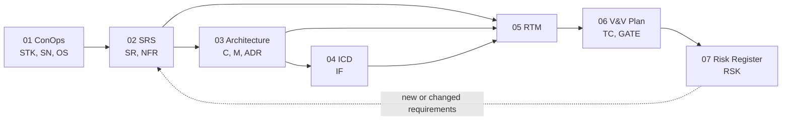

# Berlin AutoWorks — Systems Engineering Documentation

This folder is the systems engineering baseline for the Berlin AutoWorks web
application. [PLANNING.md](../../PLANNING.md) is the product plan; these
documents turn it into identified requirements, an allocated architecture,
controlled interfaces, and a trace from each need to the code and test that
satisfy it.

Each document carries stable identifiers so a requirement can be followed from
the stakeholder need that produced it to the module that implements it and the
test that verifies it.

## Document tree

| # | Document | Purpose | Primary IDs |
| --- | --- | --- | --- |
| 01 | [Concept of Operations](01-concept-of-operations.md) | Stakeholders, operational scenarios, system modes | `STK-`, `SN-`, `OS-`, `MODE-` |
| 02 | [System Requirements Specification](02-system-requirements-specification.md) | Functional and non-functional "shall" statements | `SR-<area>-`, `NFR-<area>-` |
| 03 | [System Architecture and Design](03-system-architecture-design.md) | Context, decomposition, deployment, data, state machines, decisions | `C-`, `M-`, `ADR-` |
| 04 | [Interface Control Document](04-interface-control-document.md) | Every external and internal interface and its contract | `IF-` |
| 05 | [Requirements Traceability Matrix](05-requirements-traceability-matrix.md) | Need → requirement → design → code → verification → status | — |
| 06 | [Verification and Validation Plan](06-verification-validation-plan.md) | Methods, test cases, launch gates | `TC-`, `GATE-` |
| 07 | [Risk and Hazard Register](07-risk-register.md) | Technical, security, and delivery risks with mitigations | `RSK-` |

## Identifier conventions

| Prefix | Meaning | Example |
| --- | --- | --- |
| `STK-nn` | Stakeholder class | `STK-03` Service advisor |
| `SN-nn` | Stakeholder need (problem-space) | `SN-05` Pay an invoice safely online |
| `OS-nn` | Operational scenario | `OS-02` Guest books a service |
| `MODE-nn` | System operating mode | `MODE-03` Degraded: no email provider |
| `SR-<AREA>-nnn` | Functional system requirement | `SR-BIL-005` Webhook signature verified |
| `NFR-<AREA>-nnn` | Non-functional requirement | `NFR-SEC-004` Private routes uncached |
| `C-nn` | Physical / runtime component | `C-01` Next.js web app |
| `M-<CODE>` | Logical domain module | `M-BIL` billing |
| `IF-nn` | Interface | `IF-04` Stripe webhook |
| `ADR-nn` | Architecture decision record | `ADR-01` Modular monolith |
| `TC-<AREA>-nnn` | Verification test case | `TC-BIL-003` |
| `GATE-nn` | Launch gate | `GATE-02` Security smoke |
| `RSK-nn` | Risk | `RSK-01` Unverified email links guest records |

Functional area codes: `PUB` public site, `BOOK` scheduling, `EST` estimates,
`REP` repair orders, `BIL` billing, `CUS` customers and vehicles, `IDN`
identity and access, `ADM` staff workspace, `AUD` audit, `FIL` files, `NTF`
notifications, `LOC` locations.

Non-functional area codes: `PERF`, `REL`, `SEC`, `PRIV`, `SEO`, `A11Y`, `OBS`,
`MNT`, `CMP` (compliance), `RND` (rendering and caching).

## Status vocabulary

Used in the SRS and RTM. Status describes the code on the branch this
document was written against, not the plan.

| Status | Meaning |
| --- | --- |
| **Implemented** | Code path exists and is wired end to end when its environment variables are set |
| **Partial** | Schema, types, or one half of the flow exists; the requirement is not yet met |
| **Not started** | Route or placeholder only; no behaviour |
| **Deferred** | Out of launch scope by decision (PLANNING.md Appendix A) |

## Verification methods

Standard INCOSE / IEEE 15288 methods:

| Code | Method | Used for |
| --- | --- | --- |
| **T** | Test | Automated unit, integration, or end-to-end test with pass/fail criteria |
| **D** | Demonstration | Operating the system and observing the result, without instrumentation |
| **I** | Inspection | Reading code, schema, configuration, or content |
| **A** | Analysis | Measurement, modelling, or calculation (Lighthouse, load test, threat model) |

## Baseline

| Item | Value |
| --- | --- |
| Baseline date | 2026-11-10 |
| Code baseline | `5ba429c` Load signed-in customer appointments, vehicles, and profile |
| Source plan | PLANNING.md (planning baseline for launch scope) |
| Schema baseline | `prisma/migrations/20261109170000_launch_integrations` |

## Maintaining these documents

1. **A new feature** starts as a requirement in 02, then gets a row in 05 and a
   test case in 06 before the pull request merges.
2. **A changed interface** (new provider, new webhook event, new route handler)
   updates 04 and, if it changes a contract, adds an `ADR-` entry in 03.
3. **A status change** (Partial → Implemented) is made in both 02 and 05 in the
   same pull request as the code. The RTM is the place reviewers check.
4. **A risk that is closed** keeps its row in 07 with status `Closed` and the
   commit or pull request that closed it. IDs are never reused.
5. Re-baseline the table above when a release is cut.
